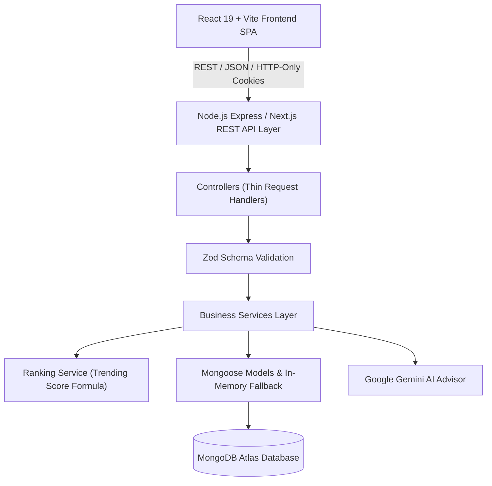

# Foundlily High-Level (HLD) & Low-Level Design (LLD) Blueprint

## 1. System Overview
Foundlily is a high-performance full-stack web platform connecting tech startups, investors, and innovators worldwide. It provides SEO-optimized startup profiles, smart search and filtering, trending leaderboards, social engagement (following, bookmarking), analytics tracking, and administrative review workflows.

---

## 2. High-Level Architecture (HLD)



---

## 3. Low-Level Design (LLD)

### Request Lifecycle
```
Client Request -> Express Route -> Auth / Role Middleware -> Controller -> Zod Validation -> Service Layer -> Mongoose Schema -> MongoDB -> Response
```

### Profile Status State Machine
- `DRAFT` / Form Submission $\rightarrow$ `PENDING`
- Admin Reviews `PENDING`:
  - `APPROVED` $\rightarrow$ Listed publicly on Explore, Search, and SEO routes.
  - `REJECTED` $\rightarrow$ Returned to owner dashboard for revision.

### Trending Score Formula
$$\text{Trending Score} = (\text{Views} \times 0.20) + (\text{Followers} \times 0.25) + (\text{Saves} \times 0.15) + (\text{Engagement} \times 0.20) + (\text{Recent Activity} \times 0.20)$$

---

## 4. Database Schema & Collections

| Collection | Key Fields | Purpose |
|---|---|---|
| **Users** | `_id`, `name`, `email`, `passwordHash`, `avatar`, `role`, `createdAt` | Account & permissions |
| **Profiles** | `_id`, `ownerId`, `name`, `slug`, `logo`, `shortDescription`, `description`, `founder`, `categoryId`, `countryId`, `stateId`, `cityId`, `foundedYear`, `stage`, `status`, `viewCount`, `followerCount`, `saveCount`, `trendingScore` | Startup listings & metrics |
| **Categories** | `_id`, `name`, `slug`, `description`, `icon`, `isActive` | Industry classification |
| **Regions** | `_id`, `name`, `slug`, `states: [{ name, slug, cities }]` | Geographical grouping |
| **Follows** | `_id`, `userId`, `profileId`, `createdAt` (Compound index: `userId + profileId`) | User follows |
| **SavedProfiles**| `_id`, `userId`, `profileId`, `createdAt` (Compound index: `userId + profileId`) | User saved bookmarks |
| **AnalyticsEvents**| `_id`, `profileId`, `userId`, `eventType`, `metadata`, `createdAt` | Interaction audit trail |
